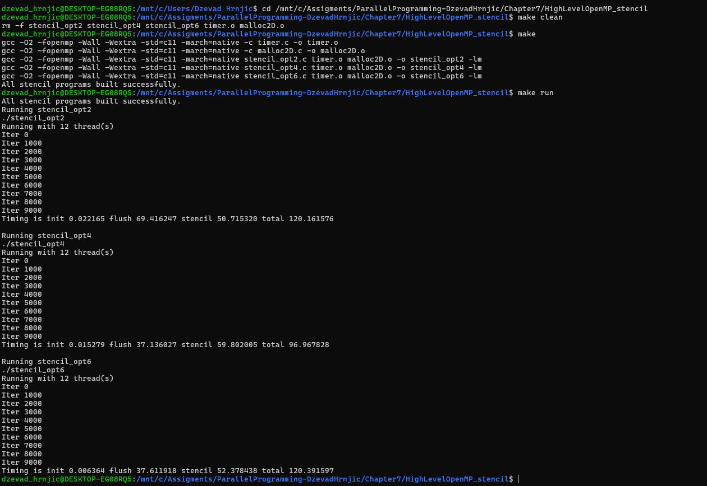

# OpenMP stencil comparison

## Task

This task compares three OpenMP stencil programs.

- `stencil_opt2.c` is the basic version.
- `stencil_opt4.c` uses one parallel region for the loop work.
- `stencil_opt6.c` also divides the work between threads by hand.

All three programs use the same grid and run 10000 stencil iterations.

## How to build and run

Use a terminal in this folder.

```text
make clean
make
make run
```

## Results

The complete results are in [results.txt](results.txt).

The programs were run with the same compiler and the same number of threads.
The times can be a little different in every run because other programs can
also use the CPU.

| Version | Threads | Init (s) | Flush (s) | Stencil (s) | Total (s) |
|---|---:|---:|---:|---:|---:|
| stencil_opt2 | 12 | 0.022165 | 69.416247 | 50.715320 | 120.161576 |
| stencil_opt4 | 12 | 0.015279 | 37.136027 | 59.802005 | 96.967828 |
| stencil_opt6 | 12 | 0.006364 | 37.611918 | 52.378438 | 120.391597 |

## Answers to the questions

The following sections answer the three questions from the assignment.

### 1. What was improved in the code?

The differences between the three versions and the used improvement strategies
are explained below.

#### stencil_opt2

This is the basic version. It starts a new `parallel for` for the flush loop
and for the stencil loop in every iteration.

The end of each `parallel for` has an implicit barrier. All threads wait there
before the next part starts.

#### stencil_opt4

This version uses one parallel region for each iteration. It uses two OpenMP
work-sharing loops inside that region.

The flush loop uses `nowait`. This removes the barrier after the flush loop.
The stencil loop still has a barrier because all threads must finish writing
`xnew` before the arrays are swapped.

This reduces the cost of creating parallel regions. It also lets some threads
continue without waiting after the flush loop.

#### stencil_opt6

This version keeps one parallel region for all 10000 iterations. It calculates
the range of rows for every thread before the loop starts.

Each thread works on its own part of the arrays. The program uses explicit
`omp barrier` directives after the stencil calculation and after the pointer
swap.

The first barrier makes sure that all values in `xnew` are ready. Thread zero
then swaps `x` and `xnew`. The second barrier makes sure that all threads see
the new pointers before the next iteration.

The initialization is also done inside the same parallel region. This avoids
starting more parallel regions.

### 2. What are explicit and implicit barriers?

An implicit barrier is added by OpenMP. For example, a normal `parallel for`
has a barrier at the end. The programmer does not write this barrier.

An explicit barrier is written by the programmer:

```c
#pragma omp barrier
```

It makes all threads wait at that point. The program uses explicit barriers in
`stencil_opt6.c` because the loop and the pointer swap are manually controlled.

The three versions therefore have different synchronization:

- `stencil_opt2` mainly uses implicit barriers from `parallel for`;
- `stencil_opt4` uses `nowait`, one implicit barrier after the stencil loop,
  and the end of the parallel region;
- `stencil_opt6` uses explicit barriers for the stencil result and pointer swap.

### 3. How many threads did the CPU use?

The number of threads is printed by every program. In the results from the
machine used for testing, the CPU used 12 threads.

## Terminal screenshot

The screenshot shows one terminal run of all three programs:


