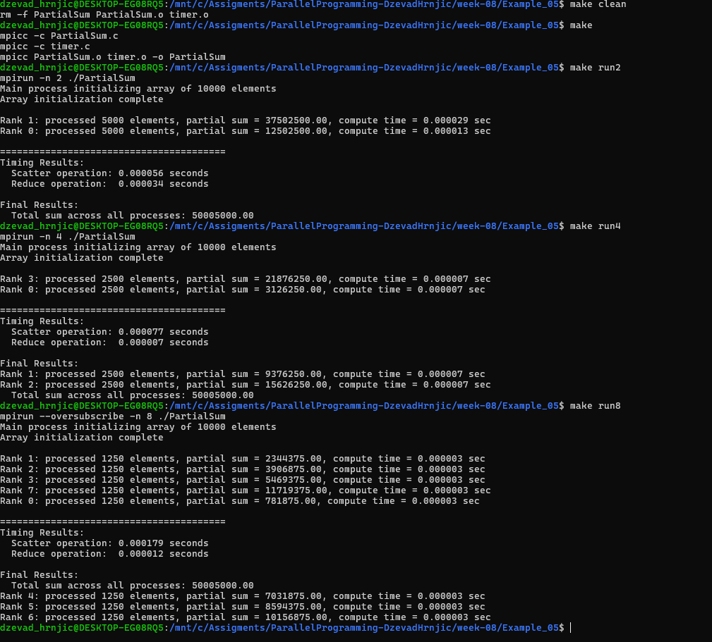

# Lab 8: MPI Partial Sum

## Task

The goal of this task was to calculate the sum of an array using multiple MPI processes. Rank 0 creates an array with 10,000 values, from 1 to 10,000. The expected total is:

```text
1 + 2 + ... + 10000 = 50005000
```

## How the Program Works

The program divides the array as evenly as possible between the processes. If the division leaves a remainder, the first few processes get one extra element:

```c
int base_size = ncells / nprocs;
int remainder = ncells % nprocs;
nsize = base_size + (rank < remainder ? 1 : 0);
```

I used `MPI_Allgather` so every process knows the number of elements assigned to each rank. The offsets are then calculated from those sizes.

`MPI_Scatterv` sends each process its part of the array. Each process adds its local values, then `MPI_Reduce` combines the partial sums with `MPI_SUM`. The final sum is available on rank 0.

The program measures the time used by `MPI_Scatterv` and `MPI_Reduce`. Rank 0 frees the global array because it allocated it; each process frees its own local array.

## Build and Run

Run these commands from the repository root in WSL or another MPI environment:

```bash
make clean
make
make run2
make run4
make run8
```

The 8-process target uses `--oversubscribe` for MPI environments that have fewer than eight available slots.

## Results

| Processes | Elements per process | Total sum |
|---:|---:|---:|
| 2 | 5000 | 50005000.00 |
| 4 | 2500 | 50005000.00 |
| 8 | 1250 | 50005000.00 |

I ran the program with 2, 4, and 8 processes. All runs returned the expected sum. The timing values are shown in the screenshot below. They can change between runs, and adding processes does not always make the communication faster because `MPI_Scatterv` and `MPI_Reduce` also have overhead.


