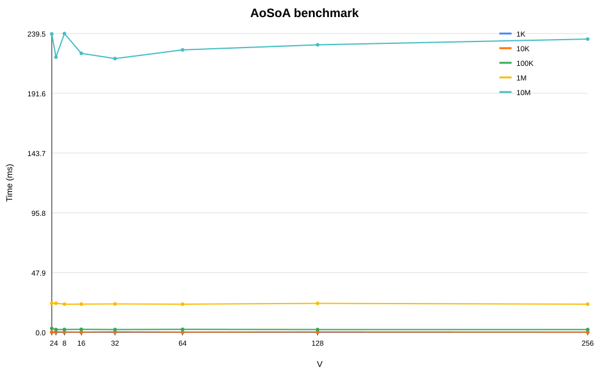

# Assignment 3 - AoSoA

## Run

```text
make test_1K
make test_10K
make test_100K
make test_1M
make test_10M
```

The results are saved in the `results_N*.csv` files. The Excel file is
[`benchmark_results.xlsx`](benchmark_results.xlsx).
Open it directly in Microsoft Excel. It contains the results table and a
chart. The table has
these columns:

`N, V, Iterations, Time (ms)`

## Explanation of results

The time increases when `N` increases because the program processes more
elements. The value of `V` changes the time because it changes the AoSoA block
size. In these tests, values around `V = 8` and `V = 16` are usually the
fastest. Small differences between runs are normal and are caused by the
computer, compiler, and current system load. Therefore, the values do not have
to be exactly the same as in the example.

## Spreadsheet and graph

Import [`spreadsheet_data.csv`](spreadsheet_data.csv) into Google Sheets and
create a line chart:

- X-axis: `V`
- Y-axis: `Time (ms)`
- one line for each `N`

[Google Sheets](https://docs.google.com/spreadsheets/d/1Lr7mPVfpvI2vKugTZWR6_Rc_ncJavvwbNcks2gYg3BQ/edit?usp=sharing)


